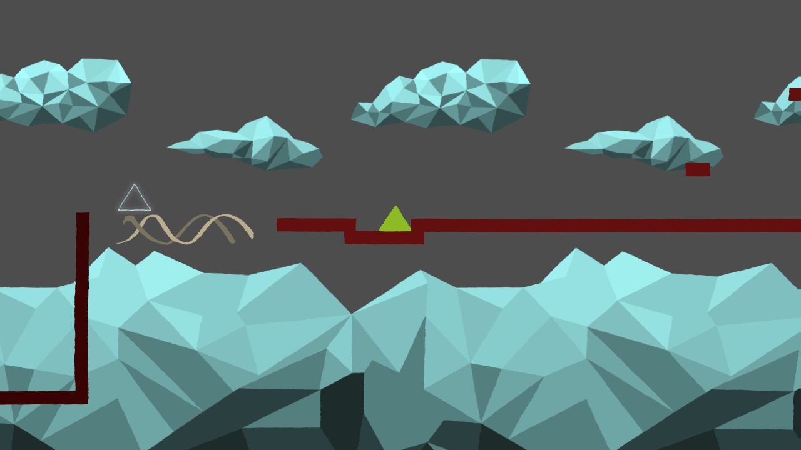

# µ

A 2D platformer about shapes and home.

**[Play it in the browser](https://incredibleleitman.github.io/Mue/)** or download it from the [releases](https://github.com/incredibleLeitman/Mue/releases).

Created at the Global Game Jam Graz 2019.

## Diversifiers
- Use the Source, Luke (Sponsored by GitHub)
- Language-Independence (Sponsored by Valve Software)
- Thomas Wasn't Alone

## Controls
Control with arrow keys or D-pad and A button.

## Build
Made with Godot 3 (exports with Godot 3.5.3). Open `Project/project.godot` in the editor.
Pushing to `main` publishes the web build on GitHub Pages, pushing a tag `v*` creates a release with
web, Windows and Linux builds.
